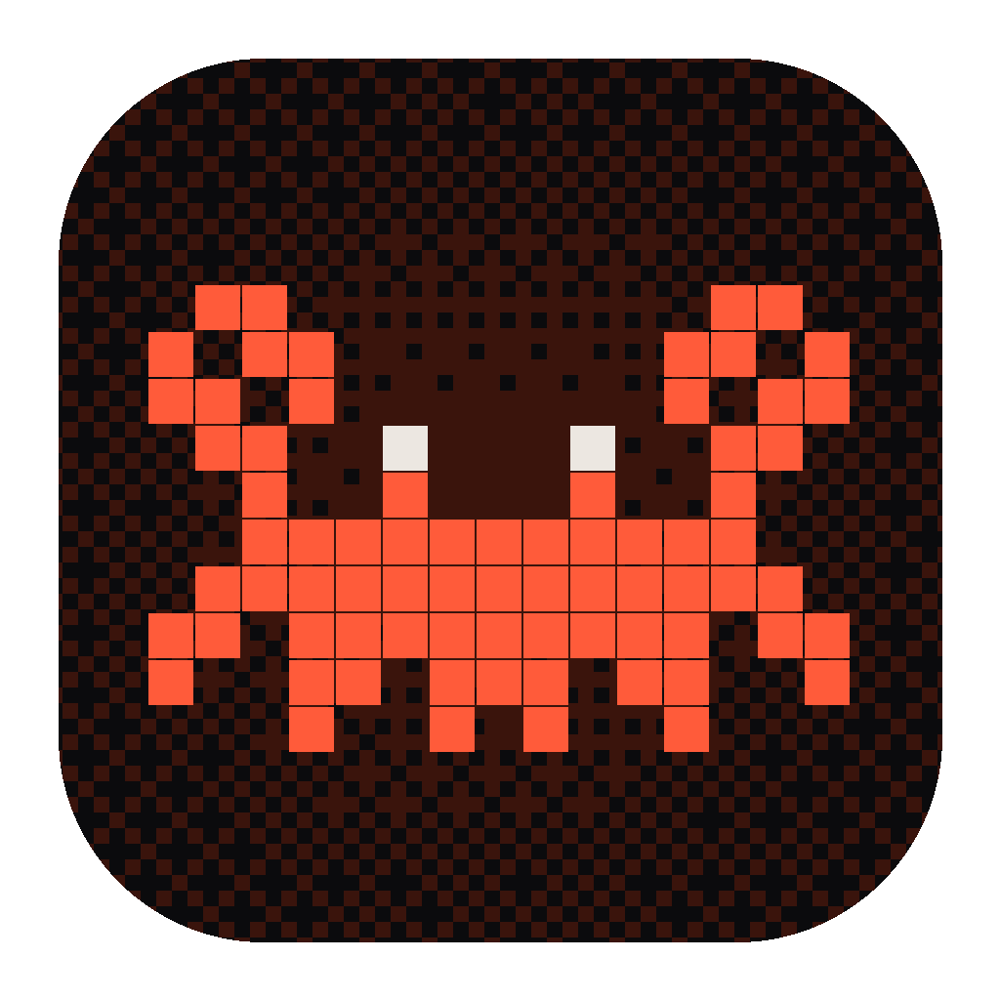
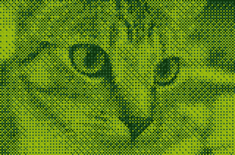
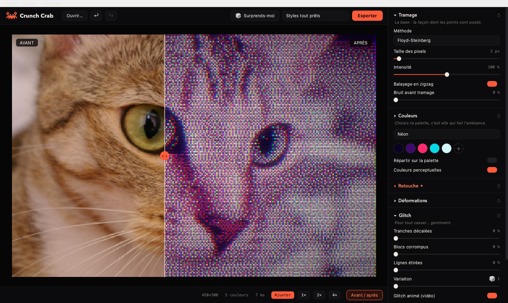
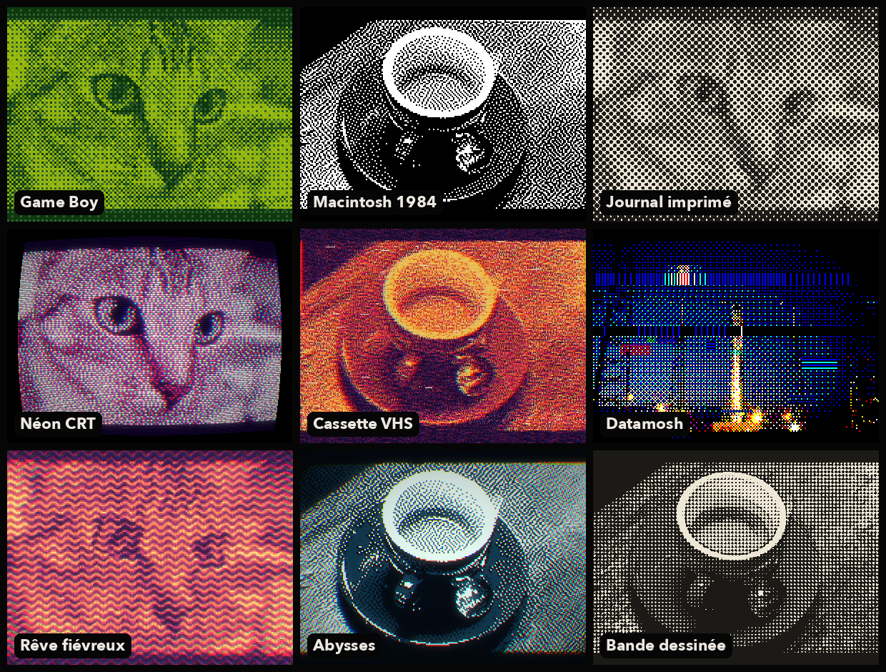

<p align="center">
  
</p>

<h1 align="center">Crunch Crab</h1>

<p align="center">
  Tramage, glitch et effets rétro pour tes images, GIF et vidéos.<br>
  Gratuit, open source, sur macOS, Windows et Linux.
</p>
<p align="center">
  <sub>Projet d'expérimentation étudiant, réalisé en partie avec l'aide de Claude Code.</sub>
</p>

<p align="center">
  <a href="https://github.com/saturnes00/CrunshCrab/releases/latest"></a>
  <a href="https://github.com/saturnes00/CrunshCrab/actions/workflows/construire.yml"></a>
  
</p>

<p align="center">
  
</p>

---

## Télécharger

| Système | Fichier | |
|---|---|---|
| **macOS** (Apple Silicon) | [CrunchCrab-macOS.zip](https://github.com/saturnes00/CrunshCrab/releases/latest/download/CrunchCrab-macOS.zip) | Dézippe, puis glisse l'app dans *Applications* |
| **Windows** 10 / 11 | [CrunchCrab-Windows.zip](https://github.com/saturnes00/CrunshCrab/releases/latest/download/CrunchCrab-Windows.zip) | Dézippe, puis lance `CrunchCrab.exe` |
| **Linux** (x86-64) | [CrunchCrab-Linux.tar.gz](https://github.com/saturnes00/CrunshCrab/releases/latest/download/CrunchCrab-Linux.tar.gz) | Décompresse, puis lance `./CrunchCrab` |

Rien d'autre à installer : Python, l'interface et ffmpeg sont inclus.

<details>
<summary><b>Premier lancement : « l'app ne s'ouvre pas » ?</b></summary>

L'app n'est pas signée par Apple ni par Microsoft (c'est payant), donc le système se méfie au premier lancement. C'est normal.

- **macOS** : ouvre l'app une fois, puis va dans *Réglages Système → Confidentialité et sécurité* et clique sur **Ouvrir quand même**. Autre solution, dans le Terminal :
  ```bash
  xattr -dr com.apple.quarantine "/Applications/Crunch Crab.app"
  ```
- **Windows** : si SmartScreen affiche « Windows a protégé votre ordinateur », clique sur **Informations complémentaires → Exécuter quand même**.
- **Linux** : lance `./installer.sh` dans le dossier pour ajouter Crunch Crab au menu des applications. Sur une installation minimale, il peut manquer `libxcb-cursor0` (`sudo apt install libxcb-cursor0`).

Le tout premier lancement prend quelques secondes de plus : le moteur se compile pour ta machine, puis c'est gardé en cache.
</details>

## Aperçu

<p align="center">
  
</p>

<p align="center">
  
</p>

## Ce qu'elle sait faire

- **23 méthodes de tramage** : Floyd-Steinberg, Atkinson, Jarvis, Stucki, Bayer, bruit bleu, trames en points, lignes, croix, vagues, demi-teinte façon journal…
- **17 palettes** (Game Boy, PICO-8, Commodore 64, CGA, néon, risographie…) + niveaux de gris, palette tirée de ton image, ou ta propre palette
- **Retouche** : luminosité, contraste, gamma, saturation, teinte, température, flou, netteté, encrage des contours
- **Déformations** : miroir et kaléidoscope, ondulation, tri de pixels
- **Glitch** : tranches décalées, blocs corrompus, lignes étirées, figé ou animé
- **Optique** : aberration chromatique, décalage RVB, bavure VHS, lueur, fuite de lumière
- **Écran** : artefacts JPEG, postérisation, bande VHS, lignes CRT, grille de phosphore, courbure, vignette, grain
- **15 styles tout prêts**, un bouton 🎲 *Surprends-moi*, annuler / rétablir, comparaison avant / après
- **Vidéo** : aperçu en temps réel, export **MP4** (avec le son), **GIF** animé, **MOV ProRes** ; et **PNG** pour les images

## Raccourcis

| | macOS | Windows / Linux |
|---|---|---|
| Ouvrir / exporter | ⌘O / ⌘E | Ctrl+O / Ctrl+E |
| Annuler / rétablir | ⌘Z / ⇧⌘Z | Ctrl+Z / Ctrl+Maj+Z |
| Enregistrer / charger un style | ⌘S / ⌘L | Ctrl+S / Ctrl+L |
| Surprends-moi | R | R |
| Comparer avant / après | C | C |
| Lecture / pause | Espace | Espace |
| Zoom | pincer, ⌘0 / ⌘1 / ⌘2 | Ctrl + molette, Ctrl+0 / 1 / 2 |

Double-clic sur un réglage : il revient à sa valeur de départ.

## Lancer depuis le code source

Il faut Python 3.12 ou plus récent.

```bash
git clone https://github.com/saturnes00/CrunshCrab.git
cd CrunshCrab
python3 -m venv .venv
source .venv/bin/activate          # Windows : .venv\Scripts\activate
pip install -r requirements.txt
python app.py
```

Pour fabriquer l'app autonome : `pip install pyinstaller && python outils/icones.py && pyinstaller crunchcrab.spec` (le résultat arrive dans `dist/`).
Sur macOS, `./creer_app.sh` crée aussi un raccourci dans *Applications* qui lance directement le code du dossier.

## Comment c'est fait

| Fichier | Rôle |
|---|---|
| `moteur.py` | Le cœur : tramage, palettes et effets. Les boucles pixel par pixel sont compilées avec [Numba](https://numba.pydata.org), c'est ce qui rend l'aperçu instantané. |
| `video.py` | Lecture et écriture des vidéos et GIF avec ffmpeg. |
| `app.py` | L'interface ([PySide6 / Qt](https://doc.qt.io/qtforpython-6/)). Les couleurs du thème sont en haut du fichier. |
| `crunchcrab.spec` | La recette [PyInstaller](https://pyinstaller.org) pour fabriquer l'app. |
| `.github/workflows/` | GitHub construit et teste l'app sur les 3 systèmes à chaque mise à jour, puis publie les versions. |

Envie d'ajouter une palette ? Une ligne dans `PALETTES`, dans `moteur.py`, suffit :
```python
"Ma palette": ["#000000", "#ff0066", "#ffffff"],
```

## À propos du projet

Crunch Crab est un projet d'expérimentation, fait par un étudiant pour apprendre et tester des idées autour de l'image, de la vidéo et des applis de bureau.

Une partie du code a été écrite avec l'aide d'outils d'intelligence artificielle. Je préfère le dire clairement : l'app fonctionne et elle est testée sur les trois systèmes, mais ce n'est pas un logiciel professionnel. Il peut rester des bugs ou des choix techniques pas idéaux.

Les retours, signalements de bugs et suggestions sont les bienvenus dans les [Issues](https://github.com/saturnes00/CrunshCrab/issues) !

## Crédits

- Photos des exemples, tirées des données de [scikit-image](https://scikit-image.org) : le chat *Chelsea* (CC0, Stéfan van der Walt), la tasse de café (CC0, Rachel Michetti), la fusée (domaine public, SpaceX).
- L'app inclut [ffmpeg](https://ffmpeg.org) (via [imageio-ffmpeg](https://github.com/imageio/imageio-ffmpeg)), distribué sous sa propre licence (GPL).

## Licence

[MIT](LICENSE) : tu peux utiliser, modifier et partager Crunch Crab librement.
